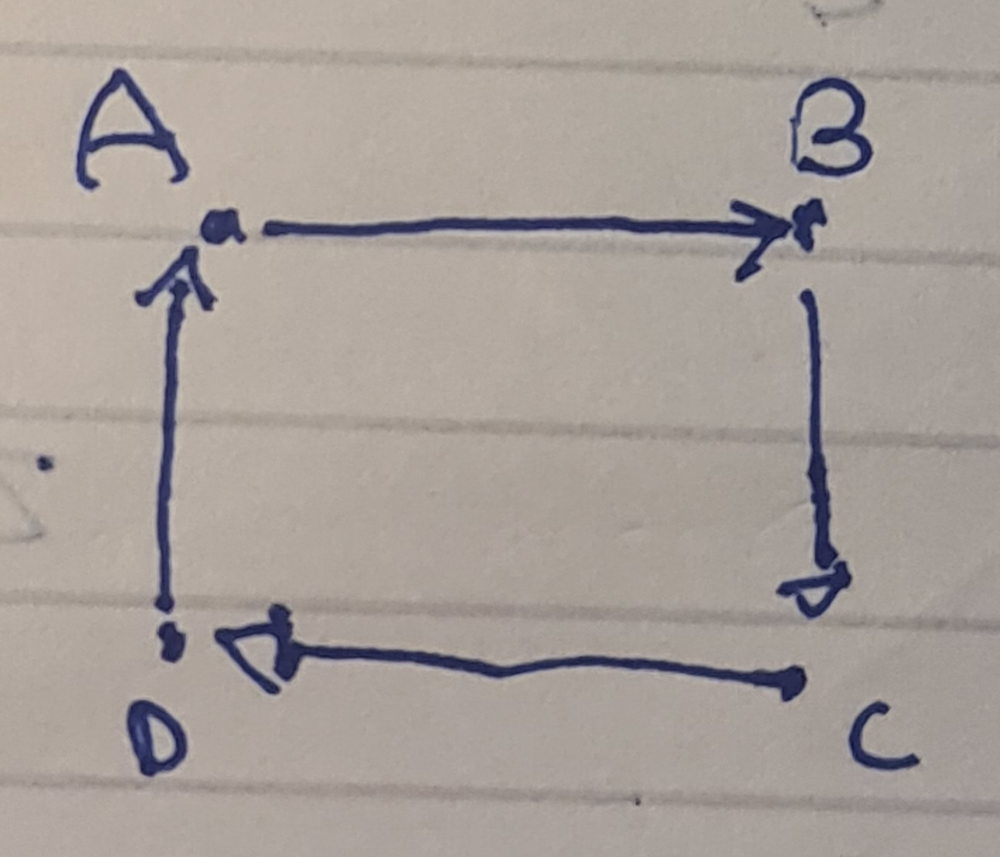
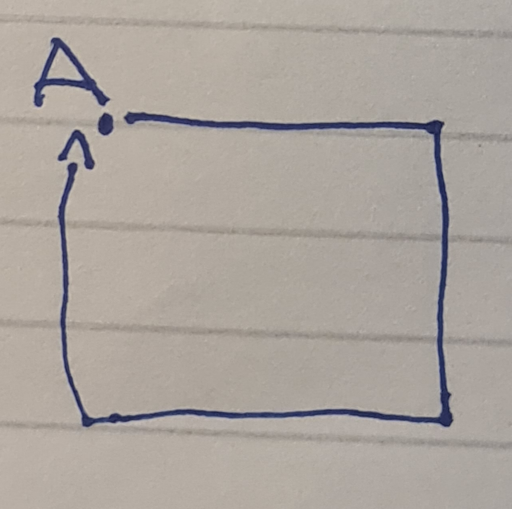
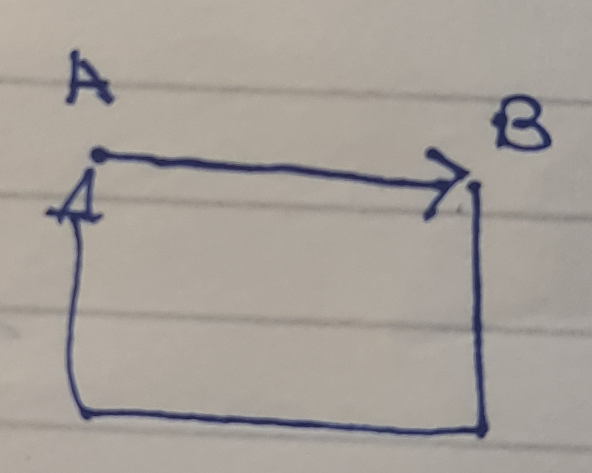
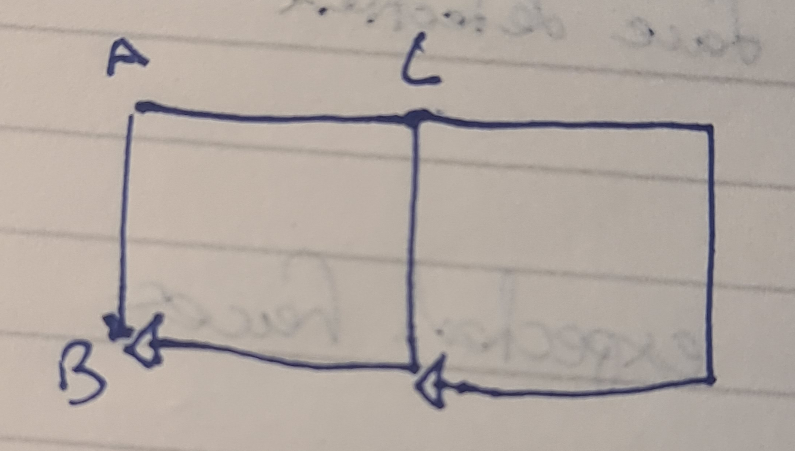
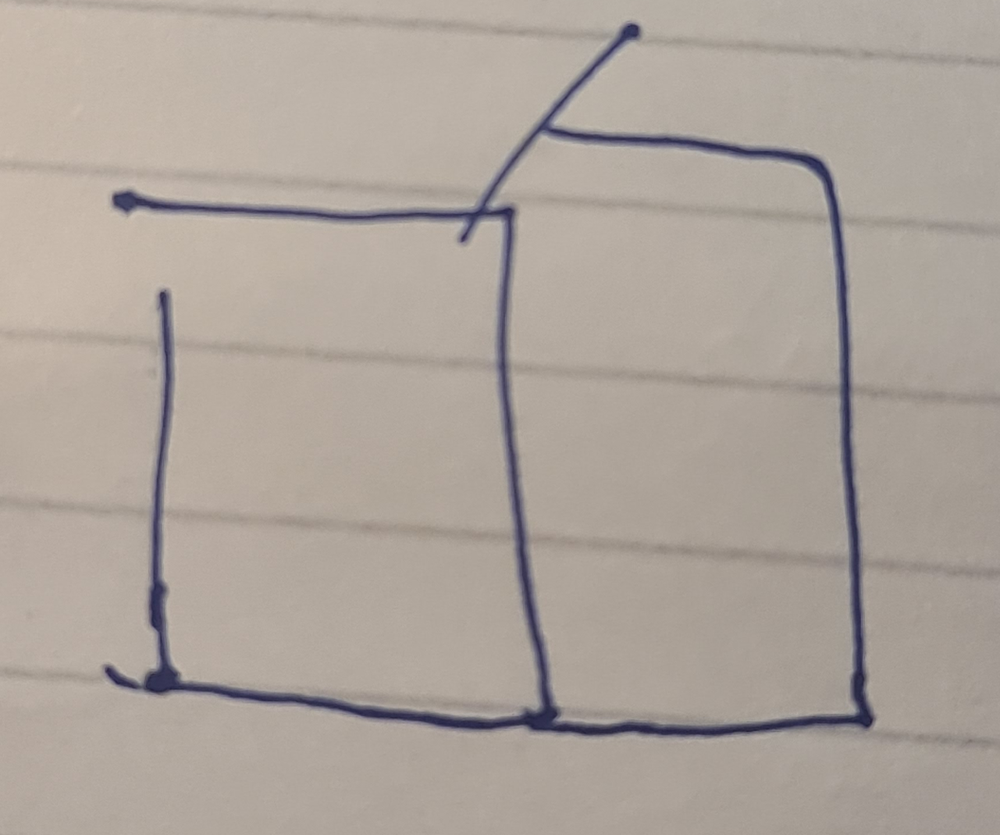
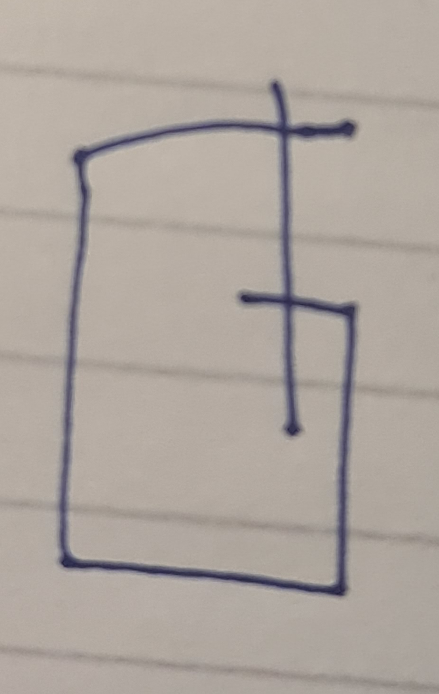
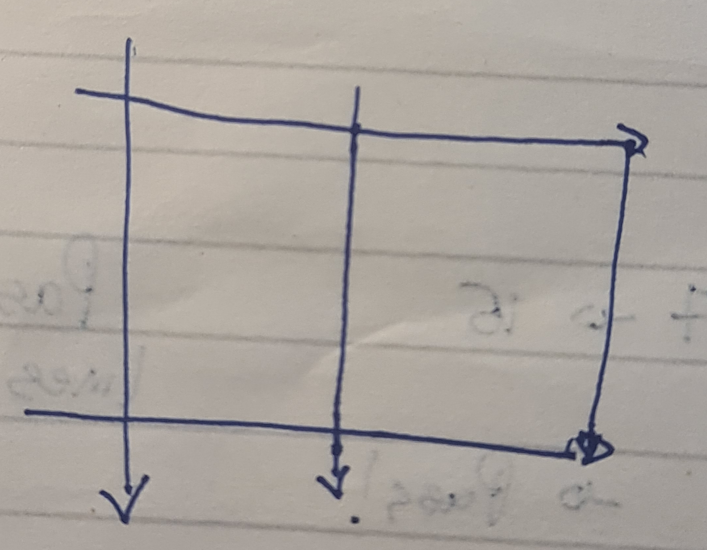
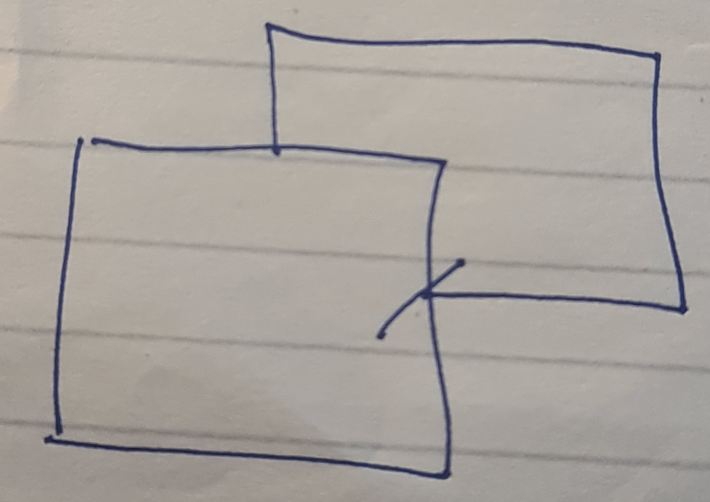
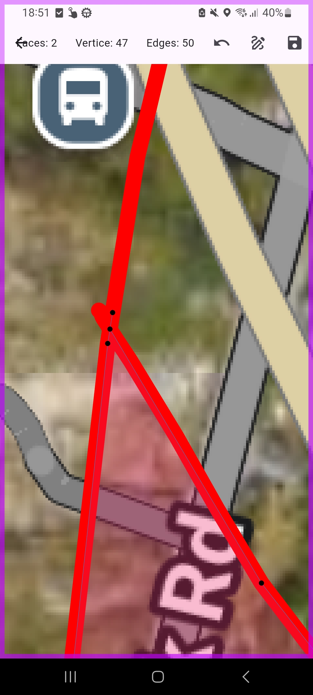

Manual Testing

Manual testing was recorded with pen and paper and has been transcribed here :

## Test 1

| *Trial* | Expected Faces | Actual Faces |
|--------|----------------|--------------|
| *1*    | 1              | 0            |
| *2*    | 1              | 1            |
| *3*    | 1              | 1            |

1: Initial test 
2: Repeat 
3: Same test reversed

## Test 2

| *Trial* | Expected Faces | Actual Faces |
|--------|----------------|--------------|
| *1*    | 1              | 1            |
| *2*    | 1              | 1            |
| *3*    | 1              | 1            |

1: Initial test 
2: Repeat 
3: Same test reversed

## Test 3

| *Trial* | Expected Faces | Actual Faces |
|--------|----------------|--------------|
| *1*    | 1              | 0            |
| *2*    | 1              | 1            |
| *3*    | 1              | 1            |

1: Initial test 
2: Repeat 
3: Same test reversed

**Changes Made:** For tests 1 and 3 -> adjusted endpointToSegmentTolerance 7 → 15

## Test 4

| *Trial* | Expected Faces | Actual Faces |
|--------|----------------|--------------|
| *1*    | 2              | 2            |

1: Initial test 

**Changes Made:** N/A

## Test 5

| *Trial* | Expected Faces | Actual Faces |
|--------|----------------|--------------|
| *1*    | 1              | 0            |
| *2*    | 1              | 1            |

1: Initial test 
2: Repeat 

## Test 6

| *Trial* | Expected Faces | Actual Faces |
|--------|----------------|--------------|
| *1*    | 1              | 0            |
| *2*    | 1              | 1            |

1: Initial test 
2: Repeat 

**Changes Made:** For tests 5 and 6 -> added graph pruning step to remove deadends and ensure graph is planar

## Test 7

| *Trial* | Expected Faces | Actual Faces |
|--------|----------------|--------------|
| *1*    | 2              | 1            |
| *2*    | 2              | 2            |

1: Initial test 
2: Repeat 

**Changes Made:** Improved endpoint to endpoint intersection logic

## Test 8

| *Trial* | Expected Faces | Actual Faces |
|--------|----------------|--------------|
| *1*    | 2              | 1            |
| *2*    | 2              | 2            |

1: Initial test 
2: Repeat 

**Changes Made:** Fixed bug where in a segment to endpoint intersection the intersection was recorded for only the segment and not the endpoint causing the graph to not be built correctly

**Note** This bug would only occur in certain conditions. To ensure the bug was handled properly, the inputs used to achieve the bug were recored and used multiple times. Unlike previous test cases where the shape was being tested, the specific inputs were required to recreate this issue.

## Test 9

| *Trial* | Expected Faces | Actual Faces |
|--------|----------------|--------------|
| *1*    | 3              | 2            |
| *2*    | 3              | 3            |

1: Initial test 
2: Repeat 

**Changes Made:** Fixed bug where a edge between two vertices was being added twice causeing the pruning to fail and causing the graph to no longer be planar. Create unique key for edges by listing the key as vertice with smaller id -> vertice with bigger id e.g. V11 -> V12 even if V12 -> V11 was the input

**Note** This bug and test 8 were randomly encountered and recorded via screenshot. Due to the home address of one of the members of this project being in the screenshot, test 8 was transcibed to paper and test 9 is zoomed in to show the important details.
