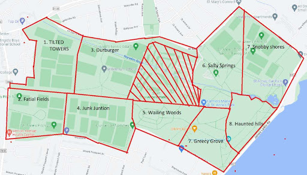

# **School of Computing — Year 4 Project Proposal Form**

## **SECTION A**

|  |  |
| ----- | ----- |
| Project Title: | Tag Battle Royale |
| Student 1 Name: | Luan Slankster |
| Student 1 ID: | 22406536 |
| Student 2 Name: | Michael Cojocaru |
| Student 2 ID: | 22380876 |
| Project Supervisor: | Darragh O'Brien |

## **SECTION B**

### **Introduction**

Tag Battle Royale will be an app that facilitates the classic game of tag but with a twist that puts it on a much larger scale. The game is designed to be played in a large space such as an outdoor park which is selected through the app and split into zones. Each player will have the app downloaded, showing them the designated zones they can be in and when those zones will close as chosen by the Chasers. A zone will close every fifteen minutes by default. The app will have map and GPS features as well as a lobby system.

### **Outline**

To create Tag Battle Royale, the following features will be needed:

##### **Lobbies and Roles**

Players will be able to host and join lobbies using a lobby code system. The host that creates the lobby can adjust settings such as time between zone closures and select the space to be played in. Players will be able to view the map, type messages, and designate their roles between each other as Chaser or Runner. The Chasers can designate the zones on the selected space and the order in which they will close.

##### **Map Editor, History and Replay**

Using an embedded map, the host can select a space to play in, e.g a park, optionally with the assistance of GPS. The Chasers can designate the zones on the selected space by drawing them into the map using the app, an example of how this will look is shown in *figure 1*. The space and the corresponding zones as well as other information about the game played such as player locations will be saved into the players’ history. Previous maps can be retrieved to be used again and previous games will have a viewable replay.

##### **Offline and Online Modes**

We expect that a consistent internet connection for each game will not be guaranteed, so we plan to develop two separate modes that the host can choose between before creating a lobby. We want to first develop an offline mode that will only need players to connect to a lobby once before the game begins. In the offline mode, the players who begin as Chasers will predefine the order in which zones will close. The Runners’ apps will download this information but keep the order hidden until the zone is set to close. The online mode will have Chasers vote on which zone to close on the fly and have positions of players displayed on the map using GPS.

##### **P2P Connection**

We want to research having the game use a wifi direct Peer-to-Peer connection in cluster between devices. This will have the benefit of not needing a central server running to create lobbies and have a faster and more stable connection. We will develop a backup server in case our plans do not come into fruition.

### **Background**

Luan played an informal version of this game a few years ago using Snapchat and Google Maps to manually draw the sections and communicate. He noticed issues such as players not being able to identify what zone they were in and messages not being delivered causing players to not know which zones are closed. We decided to create a dedicated app to solve these issues.

### **Achievements**

The project will provide a fun party game to be played with a large group. We aim to have Tag Battle Royale be playable by anyone at any age and to do this, we must make our game easy to understand and our app easy to use. We must keep this in mind when designing every part of the project, the app must work well and be accessible to be successful. This will most likely require deep research into our required tools to have a good understanding in how to use them.

### **Justification**

Tag Battle Royale will be a fun game for any large group to play. For us, the developers, creating Tag Battle Royale will give us insight into development of accessible android apps, using GPS in conjunction with maps, peer-to-peer connections and servers in the context of game development. 

### **Programming language(s)**

* The application will be solely built using Flutter framework and a number of libraries which will use Dart programming language.

### **Programming tools / Tech stack**

* Flutter Framework for building and compiling the application.  
* Android Tools for building on Android.  
* Flutter\_nearby\_connections library to be used for peer-to-peer.  
* Google\_maps\_flutter library to be used for creating play space and zones.  
* Geolocator library to be used for GPS tracking.  
* Serverpod in conjunction with Flutter to be used as the backend server.

### **Learning Challenges**

This project will be the first time we will be working on creating a usable native android app. Learning how to use Flutter Framework and Dart will be a challenge, although we are familiar with frontend web app building frameworks like React which should make things more manageable. We foresee the following tasks to be a challenge under Flutter:

* Peer-to-peer connections  
* Capturing and displaying of GPS data  
* Google Map area selection

Michael is familiar with working with maps through his third year project, which should eliminate some of the work.

### **Breakdown of work**

#### **Student 1**

Luan will develop the UI for the app. Including the Map editor, displaying the GPS information and the replay function. Although this is a frontend focused position, he will assist with the development of the peer-to-peer connections.

#### **Student 2**

Michael will look into the online section of the app. He will research into how each device will communicate with each other, including: GPS tracking, peer-to-peer connections and backend server.

### **Risk Register**

| Description | Likelihood | Severity | Mitigation |
| :---- | :---- | :---- | :---- |
| Unable to get peer-to-peer networks to function | Middling | Low | We aim to have some peer-to-peer functionality in our app, if not able to implement for online mode, fall back to only on offline and if unable there, we have the web server to use. |
| GPS functionality does not work | Low | Low | The app does not need GPS to function and can easily be built without it. |

## **Appendix**

Figure 1 A mockup showing a selected space split into zones.
